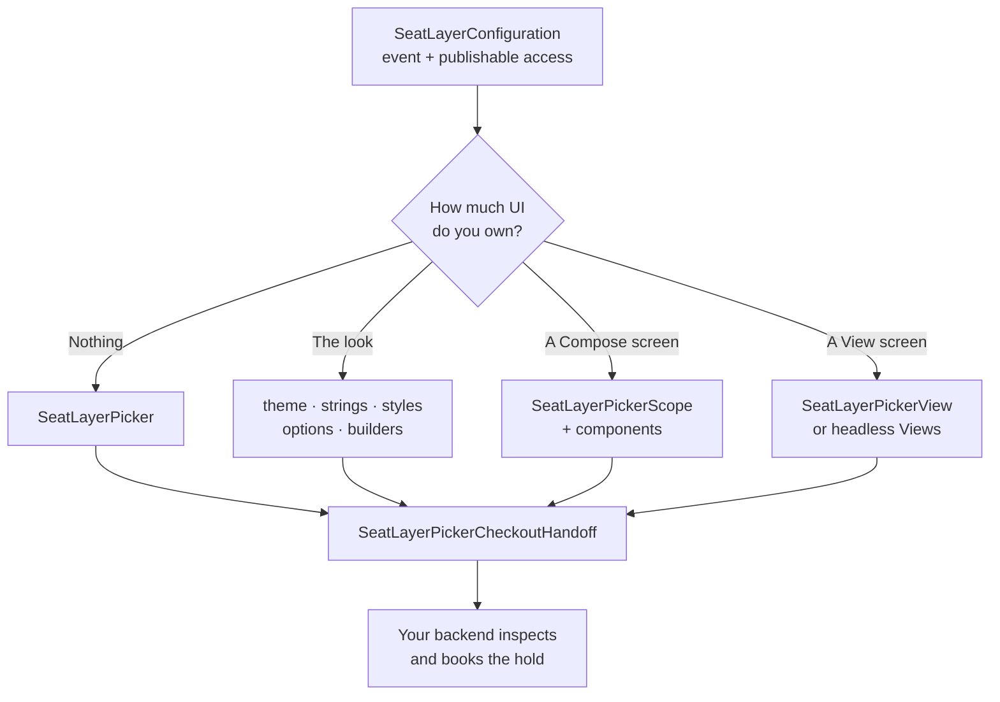

# SeatLayer SDK for Android: seat map and native seat picker for Kotlin and Jetpack Compose

[](https://github.com/seatlayer/seatlayer-android/actions/workflows/ci.yml)
[](https://central.sonatype.com/artifact/io.seatlayer/seatlayer-android)
[](https://kotlinlang.org/)
[](https://developer.android.com/)
[](LICENSE)

The official SeatLayer Android seat map SDK adds an interactive seating chart and
native seat picker to Kotlin and Jetpack Compose ticketing apps. It renders live
seat availability, creates temporary holds, finds best-available seats, and exposes every buyer action
through typed Kotlin coroutines while your trusted server completes booking.
The ready-made picker and public components use Jetpack Compose, with View/XML
interop for existing Android screens. SeatLayer is seating chart and
reserved-seat ticketing software built for venues up to stadium scale.

Version 0.3.5 includes a complete adaptive Jetpack Compose picker, reusable
native Android components and View/XML support, and keeps the `0.2.x`
`SeatLayerView` API unchanged.

[SeatLayer Android SDK on Maven Central](https://central.sonatype.com/artifact/io.seatlayer/seatlayer-android) ·
[Kotlin and Jetpack Compose seat-map guide](https://docs.seatlayer.io/buyer-sdk/android/) ·
[SeatLayer reserved-seating platform](https://seatlayer.io/) ·
[Buyer seat-map demo (web)](https://app.seatlayer.io/demo/play/grand-theatre) ·
[All live demos](https://seatlayer.io/demo/) ·
[Native picker reference](docs/native-picker.md) ·
[0.2.x migration guide](docs/migration-0.3.md) ·
[Commands and events](docs/bridge.md) ·
[SeatLayer iOS seat map SDK](https://github.com/seatlayer/seatlayer-ios) ·
[SeatLayer Flutter seat map SDK](https://github.com/seatlayer/seatlayer-flutter) ·
[SeatLayer React Native SDK](https://github.com/seatlayer/seatlayer-react-native) ·
[SeatLayer AI Toolkit](https://github.com/seatlayer/seatlayer-ai-toolkit)

> **Aligned release:** Use `0.3.5` for both Android artifacts. Pin the exact
> version in production so core and Compose cannot drift.

Two-step shape: the buyer picks and holds seats in the client with your public key, then your server confirms the booking with your secret key while your platform keeps checkout and its own payment provider.

**Start here:** [Quickstart](https://docs.seatlayer.io/start/quickstart/) · [Holds and checkout](https://docs.seatlayer.io/buyer-sdk/holds-and-checkout/) · [Android guide](https://docs.seatlayer.io/buyer-sdk/android/) · [SDK catalog](https://docs.seatlayer.io/sdk-catalog.json) · [Pricing](https://seatlayer.io/pricing/): test mode is free; live, the first 100 sold seats each month are free, then 10¢ down to 5¢ per sold seat, with no subscription, and purchased credits never expire.

## Scale evidence

Benchmarked on public 100,000-, 150,000- and 200,000-seat venue fixtures on 15 September 2026: 200,000 seats chart-ready in 1.95 s, desktop, local production build. Tested at 10,000 simulated concurrent buyers on one 12,000-seat event (18 September 2026): engine-side hold latency p99 9 ms, zero server errors. Method, fixtures and run files: https://github.com/seatlayer/seatlayer-performance. Live 200,000-seat stadium demo: https://app.seatlayer.io/demo/play/century-stadium-200k.

## Works as a native Android picker

**Every piece of buyer chrome is native Android UI.** The header, price legend,
floor and section navigation, accessibility filters, seat confirmation, tier
choices, quantity prompts, cart, hold countdown, checkout action, loading and
error states, plus the controls around 3D and panorama are Jetpack Compose
components. `SeatLayerPickerView` hosts that same native tree in a View/XML
screen, and the headless API also supports an entirely host-owned View layout.

The seat map itself (seats, labels, sections, the 3D venue and the view from a
seat) is the SeatLayer map from the web, shown inside your app, so a seat looks
and behaves the same on Android, iOS, Flutter and the web. The map leaves the
tooltip, cart, test label and checkout button to the native controls, so nothing
is drawn twice.

The integration paths form a ladder. A more custom level keeps the same
inventory, snapshots, holds, lifecycle reconciliation, and secure checkout
handoff used by the ready-made picker.

| Level | You want | You use | You keep |
| --- | --- | --- | --- |
| **1** | The complete buyer flow | `SeatLayerPicker` | Adaptive Compose UI and everything below |
| **2** | The flow in your brand | Theme, strings, styles, options, or one of 25 builders | Stock layout, state, and hold ownership |
| **3** | Your own Compose screen | `SeatLayerPickerScope` plus public components | Inventory, controller, snapshots, lifecycle, checkout |
| **4** | A View/XML screen | `SeatLayerPickerView` | The same ready-made native picker without a Compose host screen |
| **5** | Your own Android Views | `SeatLayerPickerStateHolder` plus `SeatLayerPickerMapView` | The complete headless contract and map renderer |

`SeatLayerView` remains the low-level map for existing `0.2.x` integrations that
own every buyer control and the hold themselves.



## What is included

- `SeatLayerPicker`, the complete adaptive Jetpack Compose seat-booking flow.
- `SeatLayerPickerBuilders`, themes, strings, options, and per-part styles for
  changing the product without forking it.
- `SeatLayerPickerScope` and every stock component for a host-owned Compose
  hierarchy.
- `SeatLayerPickerView` for the same ready-made picker in View/XML apps.
- `SeatLayerPickerStateHolder`, `SeatLayerPickerController`, and
  `SeatLayerPickerMapView` for a fully headless or custom-View integration.
- The frozen `SeatLayerView` and raw coroutine controller used by existing
  `0.2.x` applications.
- Typed immutable snapshots, capability-gated commands, readiness and chart-load
  telemetry, secure holds, and buyer-safe checkout handoff.
- The SeatLayer map from the web, shown inside your app. Each SDK release uses
  one matching map version.
- A generic sample covering ready Compose, branded/custom Compose, ready/custom
  View, and raw integrations.

## Packages

| Artifact | Use it for |
| --- | --- |
| `io.seatlayer:seatlayer-android` | The low-level map API, plus the picker's state, controller and map View. No Compose dependency. |
| `io.seatlayer:seatlayer-android-compose` | Ready-made picker, all native components, themes/styles/builders, and View/XML host. Strictly version-aligned with core. |

Both artifacts ship on the same release train.

## Requirements

- Android API 24 or newer; compile SDK 36
- JDK 17 for local builds
- AndroidX
- Android System WebView with the `WEB_MESSAGE_LISTENER` feature, plus `DOCUMENT_START_SCRIPT` for the
  picker. Without them `SeatLayerView` stops with a transport error that asks for a WebView update.
- `android:enableOnBackInvokedCallback="true"` on picker activities when
  targeting Android 15 or lower and predictive-back animation is required

## Install

Add both aligned `0.3.5` artifacts for the native picker:

```kotlin
// app/build.gradle.kts
dependencies {
    implementation("io.seatlayer:seatlayer-android:0.3.5")
    implementation("io.seatlayer:seatlayer-android-compose:0.3.5")
}
```

```kotlin
// settings.gradle.kts
dependencyResolutionManagement {
    repositories {
        google()
        mavenCentral()
    }
}
```

Raw-only applications can omit `seatlayer-android-compose`.

Releases before `0.2.0` used JitPack coordinates
(`com.github.seatlayer:seatlayer-android:v0.1.3`). Maven Central is the permanent
channel. Always pin an exact version; never depend on `main-SNAPSHOT`.

## Ready-made native picker

```kotlin
class CheckoutActivity : ComponentActivity() {
    override fun onCreate(savedInstanceState: Bundle?) {
        super.onCreate(savedInstanceState)

        setContent {
            SeatLayerPicker(
                configuration = SeatLayerConfiguration(
                    event = "ev_your_event_key",
                    publicKey = "pk_test_your_key",
                    currency = "USD",
                    maxSelection = 6,
                ),
                modifier = Modifier.fillMaxSize(),
                onCheckout = { handoff ->
                    checkoutBackend.start(
                        holdId = handoff.holdId,
                        amount = handoff.total,
                        currency = handoff.currency,
                    )
                },
                onError = ::reportPickerError,
                onClose = ::finish,
            )
        }
    }
}
```

The default tree includes adaptive compact/wide layouts, native header and
legend, floors and sections, accessibility filters, confirmation, GA/table
quantities, dense cart, best available, checkout, 3D/seat-view controls,
hold-lapse recovery, light/dark branding, 37 locale dictionaries, lifecycle
reconciliation, and Android predictive back.

That is the complete buyer flow: live inventory, category and accessibility
filters, venue and floor navigation, Adult/Child and other ticket types,
reserved seats, general admission and tables, cart and holds, expiry recovery,
3D and the view from a seat, and the checkout hand-off. A control appears only when the event's map supports it.
3D is offered for venues up to 30,000 seats on phones and 60,000 on desktop by default; set `max3DSeats` to change it.

Register the exact renderer origin `https://cdn.seatlayer.io` on the publishable
key. For login-gated, presale, partner, channel, or other private inventory,
omit `publicKey` and use the renewable in-memory buyer-access provider shown
under [Checkout and security boundary](#checkout-and-security-boundary).

Give the picker a definite size and do not place the map in a scrolling list.
The canvas owns pan and pinch gestures.

Recomposition retains the active picker. Activity/process destruction creates
a new session; recover an existing hold by restoring its opaque id through
`SeatLayerPickerOptions(initialHoldId = ...)` and the same renewable
buyer-access provider. Verify that runtime-owned resume path with real
inventory, and never log the hold id.

## Customize or build your own UI

Three layers can be mixed without forking the SDK:

1. Pass `SeatLayerPickerOptions`, `SeatLayerPickerTheme`, localized
   `SeatLayerPickerStrings`, and `SeatLayerPickerStyles` to configure the
   ready-made picker.
2. Use `SeatLayerPickerBuilders` to decorate or replace any of 25 independent
   parts.
3. Use `SeatLayerPickerScope` and public components such as
   `SeatLayerPickerMap`, `SeatLayerPickerHeader`, `SeatLayerPriceLegend`,
   `SeatLayerConfirmCard`, and `SeatLayerPickerCartSheet` in a host-owned
   hierarchy.

```kotlin
SeatLayerPickerScope(
    configuration = configuration,
    callbacks = SeatLayerPickerCallbacks(
        onCheckout = ::openCheckout,
        onClose = onClose,
    ),
) {
    SeatLayerPickerLifecycle()
    SeatLayerPickerBackHandler()

    Column(Modifier.fillMaxSize()) {
        SeatLayerPickerHeader(onClose)
        SeatLayerPriceLegend()
        Box(Modifier.weight(1f)) {
            SeatLayerPickerMap(Modifier.fillMaxSize())
            SeatLayerPickerMapControls()
            SeatLayerConfirmCard()
        }
        SeatLayerPickerCartSheet()
    }
}
```

See the [native picker reference](docs/native-picker.md) for the full component
catalogue, builder context, per-part styling, localization fallback, the
mandatory test-mode label, headless state guarantees, and custom View setup.

## View and XML applications

Use `SeatLayerPickerView` for the exact ready-made tree in an existing View
screen:

```xml
<io.seatlayer.android.compose.SeatLayerPickerView
    android:id="@+id/picker"
    android:layout_width="match_parent"
    android:layout_height="match_parent" />
```

```kotlin
binding.picker.bind(
    lifecycleOwner = this,
    configuration = configuration,
    onCheckout = ::openCheckout,
    onReady = ::observeReady,
    onSnapshot = ::observeSnapshot,
    onClose = ::finish,
)
```

For fully custom Views, bind a `SeatLayerPickerStateHolder` to
`SeatLayerPickerMapView`, collect its `state`, and invoke its typed `controller`.

## Existing raw map API

The `0.2.x` low-level surface remains available and independent from the native
picker:

```kotlin
class RawMapActivity : ComponentActivity() {
    private val scope = CoroutineScope(SupervisorJob() + Dispatchers.Main.immediate)
    private lateinit var seatMap: SeatLayerView

    override fun onCreate(savedInstanceState: Bundle?) {
        super.onCreate(savedInstanceState)
        seatMap = SeatLayerView(this)
        setContentView(seatMap)

        scope.launch {
            seatMap.controller.events.collect(::handleSeatLayerEvent)
        }
        scope.launch {
            seatMap.load(SeatLayerConfiguration(event = "ev_your_event_key"))
        }
    }

    override fun onDestroy() {
        seatMap.destroy()
        scope.cancel()
        super.onDestroy()
    }
}
```

`load` is a suspending function returning `ReadyInfo`: negotiated protocol,
event mode (`live` or `test`), transport, and event key. Await it before sending
commands. You can call the controller from any thread; the SDK moves the work
to the main thread itself.
Collect `controller.events` inside `repeatOnLifecycle` when a raw screen should
stop observation outside its active lifecycle.

`SeatLayerView` keeps its `0.2.x` behavior, so adding the Compose picker never
changes an existing raw integration. See the [Android 0.3 migration guide](docs/migration-0.3.md)
for dependency choices, lifecycle differences, and an adoption checklist.

### Hold seats with the raw API

Seat selection happens inside the map. A raw integration creates a short-lived
hold and transfers only its opaque id to the host backend:

```kotlin
scope.launch {
    val hold = seatMap.controller.hold(ttlMillis = 10 * 60 * 1_000)
    if (hold != null) {
        checkoutWith(
            holdId = hold.holdId,
            expiresAt = hold.expiry,
            items = hold.items,
        )
    }
}
```

`HoldResult.timeRemainingMillis` can drive a host-owned countdown. The backend,
not the app, inspects those hold items and decides the payable amount.

### Raw commands, events, and configuration

The coroutine controller covers holds, best available, general admission,
tiers, selection, categories, floors, view modes, and camera operations:

```kotlin
val controller = seatMap.controller

val seats = controller.getSelection()
val hold = controller.getCurrentHold()
controller.extendHold()
controller.release()

controller.bestAvailable(quantity = 4)
controller.holdGeneralAdmission(areaId = "floor", quantity = 2)
controller.setSeatTier(seatId = "A-12", tierId = "adult")
controller.selectObjects(listOf("A-12", "A-13"))
controller.setFloor("balcony")
controller.setViewMode(SeatLayerViewMode.Isometric)
controller.setColorblindSafe(true)
controller.zoomToFit()
```

The complete raw command surface is `hold` · `resumeHold` · `extendHold` ·
`release` · `releaseLabels` · `bestAvailable` · `holdGeneralAdmission` ·
`setSeatTier` · `getSelection` · `getCurrentHold` · `selectObjects` ·
`deselectObjects` · `clearSelection` · `selectCategories` ·
`deselectCategories` · `setSelectableObjects` · `setMaxSelection` ·
`getSelectionValidity` · `refreshAccess` · `getGeneralAdmissionAreas` ·
`getFloors` · `setFloor` · `setColorblindSafe` · `setViewMode` · `getViewMode` ·
`zoomIn` · `zoomOut` · `zoomToFit` · `destroy`.

Before using an additive raw command against an older renderer, inspect the
negotiated bundle capability. Unknown events remain available as
`SeatLayerEvent.Unknown`, and unknown value-class strings are preserved rather
than crashing an older application.

```kotlin
if (controller.bundle.value?.supportsCommand("bestAvailable") == true) {
    controller.bestAvailable(quantity = 2)
}
```

`controller.events` emits `SelectionChanged` · `SelectionValidityChanged` ·
`SelectionValid` · `SelectionInvalid` · `SelectionLimitReached` ·
`BuyerAccessExpired` · `BuyerAccessUnavailable` ·
`SelectedObjectsUnavailable` · `HoldChanged` · `HoldRestored` · `HoldExpired` ·
`GeneralAdmissionClicked` · `Hint` · `Error` · `SeatHovered` · `DeckTapped` ·
`Checkout` · `Unknown`. See the [command and event reference](docs/bridge.md) for
the exact contract.

`SeatLayerConfiguration` accepts:

| Option | Purpose |
| --- | --- |
| `event` | Required public event key. |
| `apiBase` | Optional SeatLayer API endpoint override. |
| `publicKey` | Optional publishable SDK key; never provide a secret key. |
| `maxSelection` | Maximum buyer selection. |
| `selectedObjects`, `selectableObjects` | Initial selection and selectable allow-list. |
| `numberOfPlacesToSelect`, `selectionValidators` | Exact-count and adjacency/orphan rules. |
| `buyerAccessToken`, `buyerAccessTokenProvider` | One-shot or renewable private buyer access. |
| `locale`, `messages` | Locale and runtime message overrides. |
| `currency` | Buyer-facing currency. |
| `colorblindSafe` | Accessible palette preference. |
| `initialView` | Flat, isometric, or perspective view. |
| `showsWebSeatTooltip` | Shows the map's own seat tooltip; off by default. |
| `commandTimeoutMillis` | Per-command timeout; defaults to 15 seconds. |
| `handshakeTimeoutMillis` | Initial ready timeout; defaults to 30 seconds. |
| `hostInfo` | Extra host identification sent with the handshake. |

Private bearer values remain memory-only and are never placed in the page URL
or emitted through public diagnostics. The provider is called with a typed
reason (`initial`, `expiring`, `expired`, `unauthorized`, `reconnect`, or
`manual`); a provider failure is reported without leaking its exception message.

### Layout

Give the map a definite height or make it full-screen. Do not place it in a
`ScrollView`, `NestedScrollView`, lazy list item, or another gesture-driven
container. The venue canvas owns tap, pan, pinch, panorama drag, and immersive
camera gestures; the SDK turns off the scrollbars, over-scroll and zoom controls
that would compete with it.

## Checkout and security boundary

The app selects and holds inventory. A trusted backend inspects and books the
hold after payment or order validation.

- Never ship a SeatLayer secret key in the APK or its configuration.
- Pass only the opaque checkout `holdId` and normal order context to the backend.
- Calculate payable totals from server-inspected hold items, not app input.
- Reuse a stable order id as the booking reference for safe retries.

Private events should use a renewable in-memory provider:

```kotlin
SeatLayerConfiguration(
    event = "ev_private",
    buyerAccessTokenProvider = { context ->
        buyerBackend.mintSeatLayerBuyerAccess(context.reason)
    },
)
```

The map accepts messages only from SeatLayer's own HTTPS address. The SDK blocks
navigation away from it, file access, pop-ups and third-party cookies.

## Headless picker behavior

`SeatLayerPickerStateHolder.state` is a `StateFlow` of immutable snapshots and
native presentation state. `SeatLayerPickerController` provides serialized
suspending commands for selection, filters, floors/sections, view modes,
camera, GA/tables, holds, best available, lifecycle refresh, checkout handoff,
undo, back, and close.

Snapshots are accepted only for the configured event and current session, and
only at increasing revisions. Optional malformed fields are ignored without
discarding a valid snapshot; invalid schema/session/revision/event identity is
rejected. Empty UI appears only when the runtime gives affirmative sold-out or
all-unavailable evidence.

## Buyer journey and capability ownership

The ready picker and the public building blocks consume the same semantic
state. Custom hosts therefore do not lose typed tiers, immersive targets,
accessibility groups, hold ownership, retry state, or capability information.

| Buyer capability | Native Android owns | SeatLayer renderer/runtime owns |
| --- | --- | --- |
| Loading and readiness | Branded skeleton, progress hierarchy, retry/error UI | Document load, protocol handshake, ready snapshot |
| Failure and empty inventory | Actionable messages, retry/close actions, sales-closed and test disclosure | Authoritative failure, sold-out, all-unavailable, and sales state |
| Venue navigation | Legend, floors, section dock/list, overview/step-out controls | Map geometry, focus, camera, authored floor/section data |
| Filters | Category chips, runtime-authored accessibility sheet, limited-view and colorblind controls | Availability counts and authoritative filtered map |
| Reserved seats and tiers | Confirmation card, visible tier choices, guidance, enabled/disabled actions | Seat identity, price, tier metadata, selection validity |
| GA and tables | Quantity prompts, bounds, totals, loading and errors | Capacity, min/max occupancy, hold mutation |
| Cart and holds | Dense ticket list, remove/undo, countdown, lapse recovery, Continue | Authoritative cart, hold TTL/owner, refresh outcome |
| Checkout | One serialized handoff and host callback | Opaque hold capability and priced line items |
| Venue 3D | Native mode, target, previous/next, recenter and navigation controls | 3D scene pixels, camera, target and neighbour metadata |
| Seat-view panorama | Caption, badge, native Back coordination, unavailable state | Panorama pixels, drag gestures, exact target restoration |
| Responsive/system UI | Compact/wide composition, safe drawing, gesture insets and Android Back | Viewport inset application inside the map |

Optional operations are exact capability-gated. An older runtime never receives
a command it did not advertise. In particular, native panorama Back sends
`picker.closeSeatView` only when that exact command is present. The pinned
hosted `0.71.5` runtime does not advertise it, so its own panorama close control
remains authoritative; this README does not claim hosted native-Back support
for that path.

## Selection, cart, holds, and checkout

The confirmation card keeps a seat pending until the buyer accepts it. When a
seat has Adult, Child, guided, restricted, or other runtime-authored tiers, the
tier choices and buyer guidance stay visible. `confirmPending(tierId)` sends
`picker.setSeatTier` before accepting the pending seat, so the cart never
briefly confirms the wrong tier.

GA and variable-table prompts validate quantity against runtime capacity and
occupancy rules. Confirmed seats, GA quantities, and tables all enter one dense
cart projection. Removing a line opens a session-scoped undo window; undo is
offered only while that exact line remains absent from the same session.

The picker serializes inventory mutations and repeated checkout taps. Checkout
returns one `SeatLayerPickerCheckoutHandoff` containing the opaque `holdId`,
server expiry, currency, priced line items, and display total. The ordinary
snapshot intentionally contains only hold status, expiry, and owner, not the
hold id. A successful handoff transfers ownership to the host; closing before
handoff releases picker-owned inventory, while closing afterwards never
releases the host-owned hold. If the host checkout callback throws, only that
exact handoff is rejected and ownership returns safely.

## Lifecycle, Back, and recovery

The ready picker installs lifecycle, haptic, and Android Back behavior. A
return from background or host checkout refreshes availability when supported,
reconciles server hold state, reports seats lost to another buyer, and presents
one hold-lapse recovery message. **Select them again** reselects only seats that
remain available; it never pretends an unavailable seat was recovered.

Hardware and predictive Back consume one semantic layer at a time: quantity
prompt → expanded cart → panorama → venue 3D → seat confirmation → focused
section → host close. Custom Compose hosts install `SeatLayerPickerLifecycle`,
`SeatLayerPickerBackHandler`, and `SeatLayerPickerHapticEffects`, or provide
equivalent behavior around the same controller.

Ordinary recomposition retains the session. A configuration-handled rotation or
window resize moves the renderer between compact and wide layouts without
discarding cart or camera state. Activity/process recreation creates a new
session; recover a host-retained hold with `initialHoldId` and the same renewable
buyer-access provider, then let the runtime authoritatively resume it. Android
saved state alone is not proof that inventory is still held.

## Adaptive UI, theme, and accessibility

`SeatLayerPickerLayoutMode.Adaptive` uses compact phone chrome and a wide side
panel according to the space the picker actually receives, so portrait,
landscape, tablet, foldable, split-screen, and resizable windows share one
component tree. Safe-drawing and gesture insets keep stock checkout actions out
of system UI.

`SeatLayerPickerThemeMode.Auto` follows Android system light or dark appearance
and updates both native chrome and renderer color roles without remounting the
session. A host can pass an explicit mode or theme. Event branding supplies
defaults; an explicit `SeatLayerPickerTheme`, `SeatLayerPickerStyles`, or
per-part style wins. Interactive geometry never shrinks below 48dp even when
visual padding or radius is customized.

All stock controls expose TalkBack labels, roles, state, enabled/disabled
semantics, and traversal order. The layouts support large font scale without
clipping the bottom action, mirror directional UI in RTL, preserve
runtime-authored accessibility groups, and avoid relying on color alone for
selection, errors, or availability.

## Native component catalogue

Every builder receives `SeatLayerPickerPartContext`: immutable state, the
accepted snapshot, native presentation state, typed controller, resolved theme,
strings, options, global styles, and the style for that part. Each builder also
gets the stock part as its second argument (`defaultContent` in the examples):
call it to decorate the stock component, or leave it out to replace only that
part.

| Builder part | Stock public component |
| --- | --- |
| `Header` | `SeatLayerPickerHeader` |
| `Legend` | `SeatLayerPriceLegend` |
| `FloorSelector` | `SeatLayerPickerFloorSelector` |
| `FloorStrip` | `SeatLayerFloorStrip` |
| `SectionNavigator` | `SeatLayerPickerSectionNavigator` |
| `DockBar` | `SeatLayerDockBar` |
| `AccessibilityFilters` | `SeatLayerPickerAccessibilityFilters` |
| `Map` | `SeatLayerPickerMap` |
| `MapControls` | `SeatLayerPickerMapControls` and `SeatLayerPickerZoomControls` |
| `BestAvailable` | `SeatLayerBestSeatsForm` |
| `SeatConfirmation` | `SeatLayerPickerSeatConfirmation`, `SeatLayerPickerTierSelector`, and `SeatLayerPickerTierChoices` |
| `ConfirmCard` | `SeatLayerConfirmCard` |
| `GeneralAdmissionPrompt` | `SeatLayerPickerGeneralAdmissionPrompt` |
| `TablePrompt` | `SeatLayerPickerTablePrompt` |
| `CartList` | `SeatLayerPickerCartList` |
| `CartSheet` | `SeatLayerPickerCartSheet` |
| `Venue3D` | `SeatLayerVenue3D` |
| `SeatViewChrome` | `SeatLayerSeatViewChrome` |
| `HoldCountdown` | `SeatLayerPickerHoldCountdown` |
| `HoldLapse` | `SeatLayerHoldLapseNotice` |
| `ActionError` | `SeatLayerPickerActionError` |
| `CheckoutBar` | `SeatLayerPickerCheckoutBar` and `SeatLayerBookButton` |
| `Loading` | `SeatLayerPickerLoadingView` |
| `Error` | `SeatLayerPickerErrorView` |
| `Empty` | `SeatLayerPickerEmptyView` |

The test-mode label stays outside the replacement catalogue. Public standalone
controls also include fit, overview, step-out, view-mode, 3D navigation,
colorblind and limited-view actions, plus `SeatLayerPickerUndoNotice`. The detailed
[native-picker guide](docs/native-picker.md) documents the options, builders,
headless commands, lifecycle duties, and capability matrix.

## Prepare the picker in advance (optional)

Call `SeatLayerPickerPrewarmer.prewarm(applicationContext)` while the event
details screen is visible. It never creates a picker session and never receives
an Activity, event key, public key, buyer token or hold.

```kotlin
lifecycleScope.launch {
    val result = SeatLayerPickerPrewarmer.prewarm(applicationContext)
    check(result.engineStarted)
}
```

`result.rendererPageLoaded` is `false` when only part of the preparation
finished; the picker still opens normally. Several callers share one call, and a
picker opened meanwhile waits for it.

## Build locally

```bash
./gradlew validate
./gradlew :sample:installDebug
```

`validate` runs focused unit tests, compiles the deterministic Compose
accessibility fixture and release-like Macrobenchmark, checks generated
locale/token source locks, lints and builds both artifacts, generates both
Maven POMs, verifies public API/raw ABI, builds the R8-minified consumer sample,
builds standalone raw Java/Kotlin and Compose apps from temporary Maven
coordinates on both the oldest and current supported build toolchains, verifies
that the raw dependency graph contains no Compose, and checks the retained
fixture checksum.

The external-consumer matrix is intentionally frozen rather than implied:

| Lane | JDK | Gradle | AGP | Kotlin/Compose plugin |
| --- | --- | --- | --- | --- |
| Oldest supported | 17 | 8.13 | 8.12.0 | 2.3.10 |
| Current | 17 | 9.6.1 | 9.2.1 built-in Kotlin | 2.3.10 |

Both lanes compile SDK `minSdk 24` raw Java/Kotlin and ready-made/custom
Compose/View consumers against `compileSdk 36`. The SDK itself uses Compose BOM
`2026.06.00`, Activity Compose `1.13.0`, Lifecycle `2.10.0`, and AndroidX
WebKit `1.16.0`.

The sample launches the ready-made Compose picker by default. Every supported
integration path remains runnable through the `MainActivity` intent:

```bash
adb shell am start -n io.seatlayer.sample/.MainActivity \
  --es seatlayerIntegration custom-view \
  --es seatlayerEvent ev_your_event
```

Supported values are `ready-compose`, `branded-compose`, `custom-compose`,
`ready-view`, `custom-view`, and `raw-view`. The Java/Kotlin source examples
therefore compile the default widget, full branding/part replacement, a custom
Compose composition, the ready-made View host, a pure Android View composition
over the headless controller/map, and the retained raw protocol-1 view.

When intentionally changing public API, review and refresh the checked-in dumps
with `scripts/verify-public-api.sh --write`; `validate` rejects accidental API
or raw `0.2.x` ABI drift.

## Frequently asked questions

### How do I add a seat map to an Android app?

For the complete native flow, add the aligned core and Compose artifacts and
place `SeatLayerPicker` in a bounded screen with your event configuration. It
already includes the interactive seating chart, filters, seat confirmation,
cart, holds, 3D/panorama controls and checkout handoff. 3D is offered for venues up to 30,000 seats on phones and 60,000 on desktop by default; set `max3DSeats` to change it. Existing production apps on `0.2.x` can continue to use `SeatLayerView`
and migrate to `0.3.5` when ready.

### What is native in the SeatLayer Android SDK?

Everything around the seat map: the header, filters, seat card, cart, hold timer
and checkout hand-off are Jetpack Compose components or Views you own, and your
code works with typed Kotlin models and controllers, never JavaScript. The seat
map itself is the SeatLayer map from the web, shown inside your app, so seats, prices, 3D and the view from a seat match on every platform. 3D is offered for venues up to 30,000 seats on phones and 60,000 on desktop by default; set `max3DSeats` to change it.

### Does it work with Jetpack Compose?

Yes. `SeatLayerPicker` is the ready-made adaptive Compose widget.
`SeatLayerPickerBuilders` replaces one part, and `SeatLayerPickerScope` plus the
public components builds a completely different Compose layout without losing
inventory, hold, or checkout behavior.

### Can I use it from an XML or traditional View application?

Yes. Inflate `SeatLayerPickerView` for the same ready-made picker, or combine
`SeatLayerPickerStateHolder` with `SeatLayerPickerMapView` and your own Android
Views. The raw `SeatLayerView` also remains available for existing low-level
integrations.

### Can I write the integration in Java instead of Kotlin?

Yes, from a Java app with a small Kotlin part. `SeatLayerView` is an ordinary
Android View, and a Java screen can inflate the ready-made `SeatLayerPickerView`
through a short Kotlin binding. The API is Kotlin-first (suspending functions,
`StateFlow` and `SharedFlow`), so keep the code that drives the map in Kotlin;
the rest of the app can stay Java.

### Can I restyle the picker without rebuilding it?

Yes. Use theme and theme mode for colors and type, localized strings for all
buyer copy, global and per-part styles for shapes and surfaces, options for
behavior and visibility, and one of 25 builders to replace a whole part. A
builder cannot remove the test-mode label, so a test event always says so.

### Can I build a completely different seat-picker layout?

Yes. The drop-in widget is built from the same public components exposed by
`SeatLayerPickerScope`. A custom layout receives the same immutable state,
controller, tiers, accessibility groups, immersive metadata, hold ownership,
and checkout handoff as the ready-made picker.

### How do temporary seat holds work?

The picker creates a server-timed hold that prevents concurrent buyers from
claiming the same inventory. It reconciles the hold when the app returns to the
foreground, reports expiry once, and offers to reselect only seats that remain
available. The server TTL remains authoritative if Android terminates the
process.

### Can I use my own payment provider?

Yes. Nothing in the app takes a payment. Your server reads the held seats and
their prices, charges through the provider you already use, and books the hold
with a stable booking reference.

### Can I try the Android SDK without an account?

You can see the SeatLayer picker in the live browser demo with no account. To
run the Android sample on live seats, create a test event and start the sample
with `--es seatlayerEvent <your event key>`. Test mode is free, with no time
limit and no card, and it uses no credits.

### Does the Android seat picker support dark mode, RTL, and accessibility?

Yes. The stock UI follows the system light or dark setting live and takes event
or app branding. It mirrors for RTL, scales with large fonts, carries TalkBack
labels and 48dp minimum touch targets, offers the event's accessibility filters
and a colorblind-safe palette, and keeps clear of system bars.

## Continue your Android integration

- [Follow the Android seat-map integration guide](https://docs.seatlayer.io/buyer-sdk/android/)
  for setup, lifecycle, commands, events, and runtime requirements.
- [Read the native Android picker guide](docs/native-picker.md) for the ready
  widget, customization ladder, all 25 builders, public components, headless
  controller, adaptive UI, and capability behavior.
- [Read the command and event reference](docs/bridge.md) for snapshots, command
  availability, lifecycle, checkout ownership and security.
- [Migrate from raw Android 0.2.x](docs/migration-0.3.md) without breaking the
  frozen low-level JVM surface.
- [Connect seat holds to secure server-side checkout](https://docs.seatlayer.io/buyer-sdk/holds-and-checkout/)
  without exposing booking credentials in the app.
- [Run the complete checkout example](https://docs.seatlayer.io/examples/complete-checkout/)
  to connect the buyer hold id to payment and idempotent booking.
- [Compare SeatLayer's mobile seat map SDKs](https://docs.seatlayer.io/buyer-sdk/mobile/)
  across native Android, iOS, Flutter, and React Native.
- [Explore SeatLayer 3D seating](https://seatlayer.io/3d-seat-map/) when
  evaluating immersive buyer experiences.
- [Point AI coding agents at the SeatLayer docs index](https://docs.seatlayer.io/llms.txt)
  (`llms.txt`) for an agent-readable map of the documentation.

## SeatLayer SDK ecosystem

| Surface | Package or source |
| --- | --- |
| JavaScript | [`@seatlayer/js`](https://www.npmjs.com/package/@seatlayer/js) |
| React | [`@seatlayer/react`](https://www.npmjs.com/package/@seatlayer/react) |
| React Native | [`@seatlayer/react-native`](https://www.npmjs.com/package/@seatlayer/react-native) |
| Flutter | [`seatlayer`](https://pub.dev/packages/seatlayer) |
| iOS | [`seatlayer-ios`](https://github.com/seatlayer/seatlayer-ios) |
| Android | [`seatlayer-android`](https://github.com/seatlayer/seatlayer-android) (this package) |
| Server SDKs | [Node.js, Python, PHP, Ruby, .NET, Java, and Go](https://docs.seatlayer.io/server-sdk/install/) |

See [CHANGELOG.md](CHANGELOG.md). Releases follow semantic versioning.

## License

[MIT](LICENSE)
